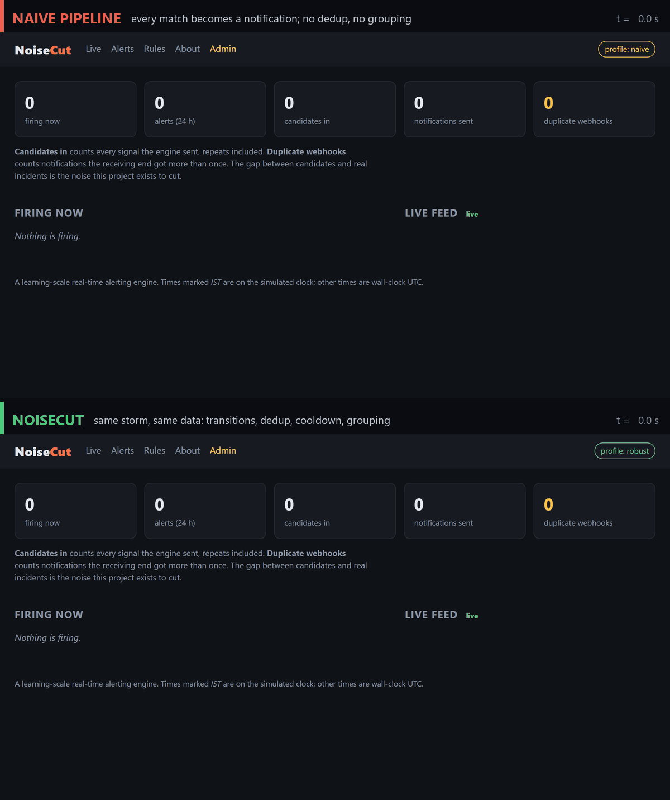
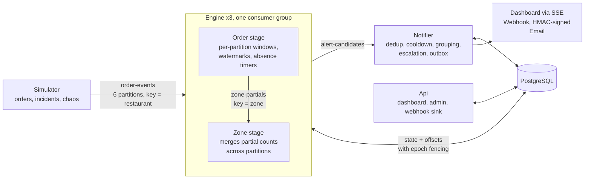

# NoiseCut

**Real-time business alerting on a Kafka-compatible stream: catches real incidents within seconds, and keeps one incident to one message.**

[](https://github.com/Kar6677thik/noisecut/actions/workflows/ci.yml)

-E2483D)


A food-delivery platform emits a continuous stream of order events. NoiseCut evaluates declarative rules against that stream
(late kitchens, cancellation spikes, orders nobody picked up), and turns what it finds into notifications a person can act on.
The design addresses the two problems that wreck production alerting: **missed or duplicated alerts** when consumers crash, rebalance
or fall behind, and **alert storms** that train people to ignore the channel.

## One incident, two engines

Eight restaurants in one zone melt down at the same time. The same data runs through two configurations of the same system.

<p align="center">
  
</p>

| Same storm, same data | Naive pipeline | NoiseCut |
|---|---:|---:|
| Incidents detected | 8 of 8 | 8 of 8 |
| Candidate signals reaching the notifier | 358 and climbing | **8** |
| Notifications sent | 712 and climbing | **2** (one grouped message per channel) |
| Duplicate webhook deliveries | 348 | **0** |

*Recorded from the live dashboard (`docker compose`, one machine). The top panel is shown at 12× speed, the bottom at 5×.
The naive run was still going when it was cut off; the controlled experiment reached 1,164 notifications. Commands to reproduce are [below](#reproduce-the-storm).*

## Measured results

Every number comes from a scripted, reproducible experiment. The simulator's *truth log* records which incidents were really injected,
so alerts are graded rather than eyeballed ([method](docs/experiments/README.md)).

| Failure mode | Naive | NoiseCut | Mechanism |
|---|---|---|---|
| **Crashes:** 20 forced kills under 2× load | — | **21/21 incidents detected, 0 duplicate notifications** | checkpoints + idempotent intake |
| Crashes: 5 kills mid-incident | 4 extra alerts; detection delayed to 58 s | 0 extra; 19–29 s regardless | state + offsets saved atomically |
| **Out-of-order events** | 43 false alerts / sim-hour | **0** | event time, watermarks, allowed lateness |
| Consumer stalled for 120 s | 1,434 false alerts | **0** | timers driven by data, not the wall clock |
| **Alert storm** (8 restaurants, one zone) | 1,164 notifications, 566 duplicates | **4 notifications, 0 duplicates** | transitions, dedup, cooldown, grouping |
| **Scale-out:** zone rule across 3 engines | incident missed | **detected in 222 s** (1 engine: 214 s) | repartition through `zone-partials` |
| **Latency** at 782 events/s (4× load) | — | **p95 10 ms**, p99 166 ms | per-partition engines, batched checkpoints |

Details, raw result files and exact commands: [Experiment 1](docs/experiments/01-restart.md) ·
[2](docs/experiments/02-out-of-order.md) · [3](docs/experiments/03-storm.md) · [4](docs/experiments/04-scale.md) · [5](docs/experiments/05-load.md).

## Architecture



Each service is a separate .NET 10 process; Redpanda provides the Kafka API. Every service exports OpenTelemetry metrics to
Prometheus, and Grafana dashboards are provisioned as code. The decisions behind each part are recorded as
[architecture decision records](docs/adr/README.md). The complete behaviour, including edge cases, is in the [specification](docs/spec/SPEC.md).

## How it works

**Rules are data.** Rules are JSON definitions stored in PostgreSQL and validated on load. Three kinds cover the reference cases:

| Rule | Kind | Fires when |
|---|---|---|
| Restaurant delay burst | `windowed_count` | 5+ orders delayed over 15 min in the kitchen within a 10-minute sliding window |
| Zone cancellation spike | `ratio_vs_baseline` | a zone's cancellation rate is 2x the same hour last week (with a minimum volume) |
| Stuck pickup | `absence` | an order is not picked up within 20 minutes of being ready |

**Checkpointed, per-partition state.** Each partition gets its own rule engine. A checkpoint first flushes the producer, then writes
window state and the next offset in **one PostgreSQL transaction**. A crash can therefore only replay records, never lose them.
Replays are deterministic in event time and produce the same alert keys, so the notifier's idempotent intake absorbs them
([ADR-0005](docs/adr/0005-checkpoint-state-with-offsets.md), [ADR-0006](docs/adr/0006-effectively-once-via-idempotency.md)).

**Fencing and fast failover.** Every partition owner holds an epoch, and a checkpoint write must present it. A paused "zombie" process
can't overwrite its successor's state. Kafka static membership lets a restarted engine reclaim its partitions without rebalancing
the rest of the group ([ADR-0014](docs/adr/0014-fencing-tokens-and-static-membership.md)).

**Event time, not arrival time.** Windows and timers advance on per-partition watermarks, and source ticks keep idle partitions moving.
Events up to 2 minutes behind the watermark are still applied. Later ones go to a `late-events` topic, and are still allowed to
resolve absence timers ([ADR-0012](docs/adr/0012-event-time-with-ticks.md)).

**A shuffle for cross-partition rules.** Orders are partitioned by restaurant, but cancellation spikes are per zone. The order stage
publishes cumulative per-zone partial counts to `zone-partials`, keyed by zone. A second stage merges them, using the minimum watermark
across sources ([ADR-0004](docs/adr/0004-zone-repartition.md)).

**A noise pipeline that never hides a real change.** The engine emits only *transitions* (firing, resolved). The notifier applies
dedup, cooldown, per-zone grouping and wall-clock escalation, then delivers through a transactional outbox with an
`Idempotency-Key` on every webhook ([ADR-0007](docs/adr/0007-transactional-outbox.md)). Two rules keep it honest: a resolution is never
suppressed by cooldown, and a resolution nobody was told about is never sent.

**Both behaviours ship.** Each robust mechanism has a naive counterpart behind a configuration flag (`NOISECUT_PROFILE=naive`), so every
failure in the table above can be re-run on demand ([ADR-0008](docs/adr/0008-naive-modes-as-flags.md)).

## Quick start

Requires Docker. The .NET 10 SDK is only needed to run the tests and experiments.

```bash
docker compose -f deploy/compose/docker-compose.yml up -d --build
NO_START=1 ./scripts/demo.sh   # or .\scripts\demo.ps1 -NoStart: injects three reference incidents and waits for each alert
```

| URL | What |
|---|---|
| http://localhost:8080 | Dashboard: live feed, firing alerts, alert timelines, rules |
| http://localhost:8080/admin | Inject incidents and chaos (no login when running locally) |
| http://localhost:3000 | Grafana: throughput, lag, detection latency, suppression |
| http://localhost:8090 | Redpanda Console: topics, partitions, messages |
| http://localhost:8025 | Mailpit: escalation emails |

The simulated clock runs 10x faster than real time, so a 20-minute absence rule fires within about 2 minutes.

### Reproduce the storm

```bash
# NOISECUT_PROFILE=naive for the top panel, robust (the default) for the bottom one
NOISECUT_PROFILE=naive docker compose -f deploy/compose/docker-compose.yml up -d
curl -X POST localhost:8080/api/scenarios/alert-storm -H "X-Admin-Key: local-dev-admin-key" \
  -H "Content-Type: application/json" -d '{"target":"z-01","durationMinutes":15,"intensity":8}'
```

Open http://localhost:8080 and watch the counters. Run `docker compose ... down -v` before switching profiles.

### Run the experiments and tests

```bash
NOISECUT_PROFILE=robust dotnet run --project tools/NoiseCut.Experiments -- restart   # or out-of-order | storm | scale | load | all
dotnet test --project tests/NoiseCut.Core.Tests          # 118 tests, pure logic, no Docker
dotnet test --project tests/NoiseCut.IntegrationTests    # 37 tests against real PostgreSQL and Redpanda (Testcontainers)
```

Each experiment starts from empty volumes, drives the stack only through its public interfaces, and writes a JSON result file
that includes the commit, machine and configuration.

## Deployment

Production runs on single-node **k3s** and deploys only from GitHub Actions ([ADR-0016](docs/adr/0016-k3s-deployment-shape.md)):

- **Build:** SHA-tagged images go to GHCR. Runtime images are chiseled .NET: no shell, non-root.
- **Access:** the runner joins a private tailnet as an ephemeral node and authenticates as a ServiceAccount that can only touch the `noisecut` namespace.
- **Apply in two passes:** infrastructure and migrations first, then the workloads, so new code never meets an old schema. A smoke test follows. Rolling back means deploying an older SHA.
- **Runtime layout:** the engine runs as a StatefulSet, so static membership survives pod restarts. A PodDisruptionBudget keeps two of three engines up.
- **Isolation:** default-deny NetworkPolicies, read-only root filesystems, dropped capabilities, and resource limits on every container.
- **Public site:** read-only. Changes require an admin login: a PBKDF2 password hash, lockout, rate limiting, `SameSite=Strict` cookies and antiforgery tokens.

The whole deploy script can be rehearsed against a disposable k3s in Docker ([runbook](docs/runbooks/k3s-rehearsal.md)).
Operations: [bootstrap](docs/runbooks/bootstrap-home-server.md) · [deploy and roll back](docs/runbooks/deploy.md) · [rotate secrets](docs/runbooks/rotate-secrets.md).

## Repository layout

```
src/
  NoiseCut.Core/            pure logic: rule model, windows, watermarks, evaluators, notifier policy (no I/O)
  NoiseCut.Infrastructure/  Kafka, PostgreSQL (Dapper), checkpoint store, outbox, metrics
  NoiseCut.Engine/          order stage and zone stage workers
  NoiseCut.Notifier/        intake, noise policy, outbox dispatcher, escalation
  NoiseCut.Api/             Razor Pages dashboard, JSON/SSE API, admin, webhook sink
  NoiseCut.Simulator/       discrete-event order generator, incident scenarios, chaos controls
  NoiseCut.Migrator/        SQL migrations, seed data, baseline history
tests/                      unit tests (deterministic, fake clock) and Testcontainers integration tests
tools/NoiseCut.Experiments/ experiment harness that produced the numbers above
deploy/                     docker compose, k3s kustomize base and overlays, Prometheus and Grafana as code
docs/                       specification, ADRs, experiments, runbooks
```

## Stack

C# / .NET 10 · Confluent.Kafka on Redpanda · PostgreSQL 17 with Dapper and plain SQL migrations · Razor Pages and Server-Sent Events ·
OpenTelemetry, Prometheus and Grafana · xUnit v3 and Testcontainers · Docker, k3s, kustomize · GitHub Actions, GHCR, Tailscale.

## Documentation

| | |
|---|---|
| [Specification](docs/spec/SPEC.md) | event model, rule semantics, time, checkpointing, notifier policy, acceptance criteria |
| [Decision records](docs/adr/README.md) | 16 ADRs: what was decided, the alternatives, and the trade-offs |
| [Experiments](docs/experiments/README.md) | each failure measured before and after the fix |
| [Runbooks](docs/runbooks/) | bootstrap, deploy, roll back, inspect, rotate secrets |
